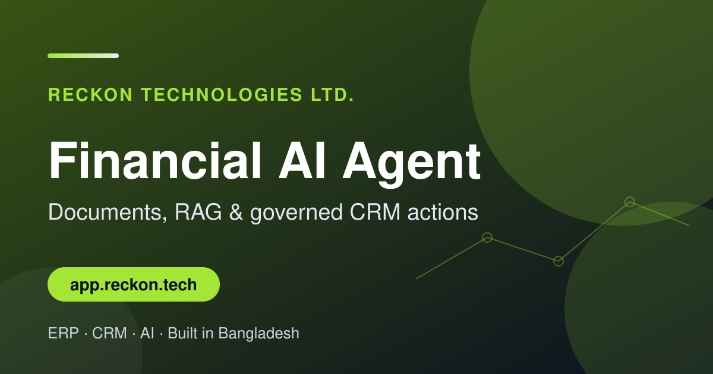

# Financial AI Agent: governed AI for finance and CRM work

Financial AI Agent is an enterprise-focused AI agent platform on the Frappe Framework from Reckon Technologies Ltd. It goes beyond a chatbot by combining AI reasoning, retrieval over your own knowledge, document extraction, tool calling, CRM actions, human approvals and audit trails in one application. It is part of the AI direction of [ReckonERP](https://app.reckon.tech).

## Detailed features

### Provider-independent AI models
- Configure OpenAI, Anthropic Claude, Google Gemini, Alibaba Qwen, OpenAI-compatible hosted services or self-hosted inference such as vLLM
- Assign different models to different workloads: reasoning, documents, tool calling, vision, fast replies and embeddings
- Capability routing, fallback, token usage tracking and sensitive-data policies

### Document intelligence
- Reads PDF, DOCX, XLSX, CSV, TXT and Markdown files in the background
- Classifies and extracts structured data from financial documents such as statements and payslips
- Confidence scores and warnings, with mandatory human review
- Financial ratios and cash-flow summaries calculated in deterministic, decimal-based code rather than by the model

### Knowledge and RAG
- Query internal policies, procedures, product documentation and compliance guidance
- Answers carry traceable source citations
- Knowledge ingestion with checksums and permission-aware search

### CRM tools with governance
- Works with Frappe CRM and Salesforce through a provider-independent connector layer
- Search leads, accounts, contacts and opportunities; review activity; prepare notes; qualify leads; create follow-up tasks; propose record updates
- Risk-based approval gates, role checks and separation of duties for sensitive actions
- Salesforce connection through OAuth 2.0 with PKCE, with tokens stored encrypted per user

### Rich responses
- KPI cards, responsive tables and charts
- CRM record cards, alerts, recommendations, citations and timelines
- Approval requests and action buttons
- Works on desktop, tablet and mobile inside the Frappe Desk

### Security and audit
- Role-based permissions and encrypted credentials
- Prompt-injection detection and secret redaction
- Per-user and per-session isolation
- Audit logs with correlation IDs

## Built on Frappe

Frappe provides the application, workflow, permissions, configuration, background jobs and user management. AI providers, CRM providers and knowledge stores plug in through modular adapters, so the platform can grow to other industries and CRMs.

## Who it is for

Finance, advisory and sales teams, and any data-heavy business, that want AI help with documents, knowledge and CRM follow-up while keeping people in control of every sensitive action.

## Try ReckonERP

- [app.reckon.tech](https://app.reckon.tech)
- [Sign up for ReckonERP](https://app.reckon.tech/reckonerp-signup)

## Related reading

- [How AI agents are changing business automation](https://app.reckon.tech/blog/how-ai-agents-are-changing-business-automation)
- [AI agent vs AI chatbot](https://app.reckon.tech/blog/ai-agent-vs-ai-chatbot)
- [Reckon blog on Hashnode](https://reckonerp.hashnode.dev)
- [Reckon Technologies on LinkedIn](https://bd.linkedin.com/company/reckontech)

## Reckon Technologies Ltd. — ERP, CRM and AI Provider in Bangladesh

Reckon Technologies Ltd. builds ERP, CRM and AI products for businesses in Bangladesh, in Bangla and English.

### Company highlights
- ERP provider with ReckonBooks, distribution and HRMS in Bangla and English
- CRM provider on Frappe CRM
- AI company with Reckon SalesPilot, an AI sales agent
- Industry modules on Frappe/ERPNext: real estate, export-import, distribution, construction, accounts and HR policy
- Guided implementation with Ask Aura AI
- Built in Bangladesh

[app.reckon.tech](https://app.reckon.tech) · [Sign up](https://app.reckon.tech/reckonerp-signup) · [LinkedIn](https://bd.linkedin.com/company/reckontech)

*Topics: AI agent, financial AI, RAG, document intelligence, CRM AI, Frappe, Salesforce MCP, Reckon Technologies Ltd, ReckonERP*
